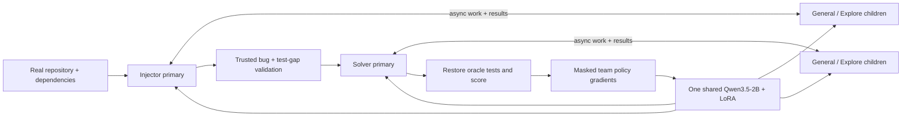

# Local multi-agent self-play RL

Train one local language model to introduce and repair bugs in real Python repositories. Both teams use the same Qwen3.5-2B weights and one shared LoRA adapter. Primary agents delegate work to subagents, keep working while they run, and receive results asynchronously. Executable tests provide rewards; every primary/child generation contributes to its team's policy-gradient update.

The project adapts [Self-play SWE-RL](https://arxiv.org/html/2512.18552v3), the [CWM training objective](https://arxiv.org/html/2510.02387v1#A3), and [OpenCode's subagent interface](https://github.com/anomalyco/opencode/blob/e761e265d2d5e6ff4a1c0756ab8d8eeee0db501e/packages/core/src/tool/plugin/subagent.ts) to one laptop GPU. It tests whether self-play gains transfer to independently held-out human bugs; [prior work](https://arxiv.org/html/2607.03523v1) shows that synthetic gains alone are insufficient evidence.

**Research status:** implementation and preregistration precede model execution. No improvement or trained-model result is claimed here. Generated results will be linked below after the first bounded pilot. The first delivery executes one pilot, not the larger seed/control study.



## Install and prepare

Run in WSL2 Ubuntu with Python 3.12, Docker Engine, an NVIDIA CUDA-capable GPU, and `uv`. The tested machine has an RTX 5070 Laptop GPU; memory feasibility is measured by preflight, not assumed from model size. Dependencies are locked in `uv.lock`; installing every package's independent latest version would violate Unsloth's compatibility requirements.

```bash
cp .env.example .env
uv sync --extra gpu --extra benchmark
uv run --no-sync selfplay doctor
uv run --no-sync selfplay prepare
```

Set `SSR_DATA_DIR`, `HF_HOME`, and `UV_CACHE_DIR` in `.env` to task-specific storage. The example uses `/mnt/d/AI/multi-agent-ssr`. Training is local; no remote model API or API key is required. Docker images and public models require network access during preparation, while agent execution has networking disabled. Never commit `.env`, private reference patches, raw credentials or model weights to Git.

Preparation pins model/source/dataset commits, builds dependency-only training images, freezes the human evaluation cohort, and prepares the independently validated diagnostic set. Humanize uses its upstream `uv build`/hatch-vcs hook to generate required version metadata. Source/data licenses and immutable revisions are retained in manifests.

## Run the research pipeline

Read [the preregistration](reports/preregistration.md) before running. Commit and push code, configuration and manifests first; the CLI enforces this ordering.

```bash
uv run --no-sync python -m pytest tests -q
uv run --no-sync selfplay preflight --run runs/pilot
uv run --no-sync selfplay pilot --run runs/pilot
uv run --no-sync selfplay report --run runs/pilot
```

Preflight verifies real generation, likelihood accounting, maximum-shape backward propagation, an adapter update and checkpoint reload. Its synthetic-check adapter is never the research initialization. The pilot evaluates the unchanged model, collects complete self-play groups, updates the shared adapter, checkpoints, and evaluates the last completed checkpoint. The persisted eight-hour deadline includes preflight and evaluations. Restarting cannot reset it.

The report command regenerates Markdown, PDF, tables, plots and dashboard data from result files. Raw prompts, complete model outputs, tool events, exact sampled token IDs, behavior log probabilities, policy versions and session-parent identities are timestamped and preserved. Terminal logging is streamed. Observations may be bounded for the model's small context; the underlying log records are not truncated.

## Method and constraints

The injector changes source code and weakens existing tests. The harness verifies clean passing tests, induced failures, successful weakening, and the causal contribution of each modified source file. The solver receives a fresh buggy snapshot and reversed test patch, with no clean implementation, injection diff or original history. Scoring restores original tests/configuration in a separate sandbox.

Each team's root and children share a terminal reward. Independent child conversations are scored in their actual contexts, not flattened into the parent's transcript. Copied child outputs are observations and are not counted twice. Inference requests take turns on one GPU while tool execution and sessions overlap; updates wait until all workers finish. The implementation uses a language-only BF16 LoRA adapter following [Unsloth's Qwen3.5 guide](https://unsloth.ai/docs/models/qwen3.5/fine-tune.md), with frozen vision, embeddings, output head and base weights.

The primary evaluation is a preregistered subset of SWE-bench Verified using its official grader. Synthetic diagnostics are reported separately. Reported scores must include coverage and paired uncertainty. This small, single-seed pilot cannot establish robustness, full-benchmark performance, absence of pretraining contamination, or a causal benefit from multi-agent delegation alone.

## Project layout

- `src/multi_agent_ssr/`: phase wrapper, shared contracts, asynchronous agents, model backend, sandbox, validator, objective, evaluations and reporting.
- `configs/` and `manifests/`: preregistered settings and frozen identities.
- `tests/`: behavior, math, isolation and pipeline checks.
- `reports/` and `docs/`: preregistration, generated experiments, methodology and sources.
- `site/`: static interactive results explorer deployed through GitHub Pages.
- `runs/` (ignored): exact private traces, temporary workspaces, checkpoints and raw outcomes.

See [optional controls and sensitivity runs](docs/controls.md), [sources and licensing](docs/sources.md), and [research instructions](AGENTS.md). Source code is MIT licensed; dependencies, pretrained weights and upstream repositories retain their own licenses.
