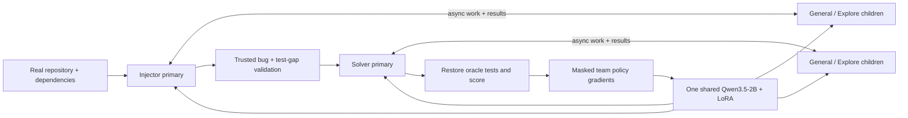

# Local multi-agent self-play RL

This repository implements a local training loop for introducing and repairing bugs in real Python repositories. Both teams use the same Qwen3.5-2B weights and one shared LoRA adapter. Primary agents can delegate work and receive results asynchronously. Executable tests provide rewards; eligible nonzero-advantage actions enter the team's policy-gradient objective once per optimization pass. The recorded pilot produced no accepted bugs or research optimizer updates; the selected adapter is unchanged from initialization. These outcomes and their evidence are generated below.

[Interactive dashboard](https://burnycoder.github.io/multi-agent-llm-self-play-reinforcement-learning-for-software-engineering/) · [Checkpoint and raw records](https://huggingface.co/BurnyCoder/multi-agent-swe-rl-qwen3.5-2b-pilot) · [Research collection](https://huggingface.co/collections/BurnyCoder/local-multi-agent-swe-rl-6ae4480aaae11ec43fdecb36) · [Paper](reports/generated/paper.pdf)

The project adapts [Self-play SWE-RL](https://arxiv.org/html/2512.18552v3), the [CWM training objective](https://arxiv.org/html/2510.02387v1#A3), and [OpenCode's subagent interface](https://github.com/anomalyco/opencode/blob/e761e265d2d5e6ff4a1c0756ab8d8eeee0db501e/packages/core/src/tool/plugin/subagent.ts) to one laptop GPU. The planned hypothesis concerns transfer to held-out human bugs. [Anchored Self-Play](https://arxiv.org/html/2607.03523v1#S4.SS4) motivates separate evaluation through function-level BugSourceBench experiments; it does not validate this repository-level method. The unchanged-weight pilot did not test the planned learning intervention.

**Research status:** the generated results below report the recorded run, checkpoint and evaluation status. A [dated recovery amendment](reports/preregistration.md#recovery-amendment-2026-11-05) preserves the interrupted initial attempt and deducts its compute charge from the recovery allocation. Preflight parameter updates are software checks, not evidence of self-play learning. The first delivery covers one bounded pilot; the larger seed/control study remains deferred.

<!-- SSR_RESULTS:START -->

Recorded run status: **pilot_failed**.

Recorded failure history (retained after later successful phases):

- 2026-11-05T21:30:15.600645+00:00, **preflight**: RuntimeError: Generation/scoring log probabilities disagree: 0.152308.
- 2026-11-05T21:58:00.073528+00:00, **preflight**: RuntimeError: Generation/scoring log probabilities disagree: 0.152151.
- 2026-11-06T04:49:29.416350+00:00, **pilot**: Worker and supervisor remained alive 45.619 seconds past the persisted wall-clock deadline; the worker process group was externally terminated. The interrupted task has no admitted score. The overrun's cause is not established..

## Interrupted attempt and recovery amendment

Prior attempt runs/pilot has recorded status preflight_failed. Its original wall-clock deadline was 2026-10-30T15:31:24.450111+00:00; original deadline preserved: True. Recorded prior failure: preflight: BrokenPipeError: [Errno 32] Broken pipe. The prior attempt's recorded elapsed time was 479.063 seconds. The recovery amendment charges 600 seconds for that attempt and allocates 28200 seconds to this recovery, within 28800 seconds of total active allocation. The amendment excludes the offline interval; it does not erase the expired original attempt. Saved prior artifacts: model outputs 0, evaluations 0, checkpoints 0. Recorded reason: User requested recovery after OS restart. Original preflight failed with BrokenPipeError; original wall-clock deadline expired. Offline interval is excluded only by the dated preregistration amendment.

## Unscored protocol diagnostics

At 2026-11-05T22:49:05.240382+00:00, episode 97baaad7b45b4308bd6fed5b9fdcc085, task pytest-dev__pytest-5631, code e49e7442f0243efcbd00879327525c4f04639a0b: chat_eos_mismatch; status interrupted_unscored. Recorded model calls: 9; generated tokens: 2094; calls continuing after chat EOS: 9. Source-model EOS IDs: [248044]; tokenizer EOS ID: 248046. Stopped at 2026-11-05T22:47:26.520168+00:00. Recorded reason: Pinned model text config stops only on endoftext; tokenizer ends assistant turns with im_end. Model generated im_end then continued fabricating user/tool observations. No completed benchmark outcome or research update preceded correction. Incomplete streaming call, if any, remains in model.jsonl but lacks a completed action record.. Correction: Stop on the deduplicated union of model and tokenizer EOS IDs. Retain stop token and its behavior log probability. No post-hoc truncation of saved trajectories; retry same task from fresh base initialization. Both evaluation conditions and all training agents use the corrected stop contract..

These are unscored harness diagnostics, excluded from benchmark success and training. Their recorded calls and tokens remain visible as physical model usage; action-event counters retain the corresponding diagnostic events without adding these summaries again. Model-authored role or observation text is generated text; only recorded harness tool events establish actual tool execution.

| Bug source | Condition | Planned | Attempted | Resolved / scored | Rate | Unscored recorded | Unrecorded |
| --- | --- | ---: | ---: | ---: | ---: | ---: | ---: |
| human | base | 32 | 22 | 0 / 21 | 0.0% | 11 | 0 |
| human | final condition | 32 | 30 | 0 / 29 | 0.0% | 3 | 0 |
| synthetic | base | 16 | 0 | Not evaluated | Not evaluated | 16 | 0 |
| synthetic | final condition | 16 | 0 | Not evaluated | Not evaluated | 16 | 0 |

Recorded research optimizer steps: 0. The initial and selected adapter weights and configurations have identical SHA256 digests and the same pinned base identity. This is two evaluations of unchanged weights, not an estimated self-play training effect. The planned learning hypothesis was not tested by this unchanged-policy comparison. The raw trained label and mechanical preregistered interval decision are preserved for provenance.

### Human bugs

Across 21 paired tasks, the final-minus-base resolution difference was +0.0 percentage points (95% paired bootstrap interval [+0.0, +0.0]). Improved: 0; regressed: 0; unchanged: 21. The mechanical preregistered interval rule contradicts the predicted improvement. This rule alone does not establish that the planned learning intervention occurred. The bootstrap interval is degenerate; it does not establish equivalence or rule out a population effect.

### Synthetic bugs

Not evaluated: no tasks have completed outcomes for both conditions.

## Recorded training outcome

Completed collection groups: 2 (with saved training_group outcomes); valid bugs / injector episodes: 0 / 4; recorded repair attempts: 0; zero-advantage episodes: 4; optimizer steps: 0. Collection groups with sampled actions but only zero advantages: 2. Subtracting the length-weighted group mean turns equal returns into zero advantages. These groups had no nonzero-advantage action tokens and recorded no learning update. Saved invalidity reason counts across all logged artifact checks, including incomplete collections: {"At least one test target is required": 4}.

| Deferred condition | Purpose | Result |
| --- | --- | --- |
| single-agent self-play | Separate delegation from self-play training | Not run |
| repair-only training | Control for updating the injector | Not run |
| procedural-mutation training | Control the training bug distribution | Not run |
| no-delegation evaluation | Measure inference-time delegation dependence | Not run |
| seed sensitivity | Measure training-seed variation | Not run |

The saved official reports contain 208 PASS_TO_PASS failure entries across 9 scored rows. Of those rows, 9 submitted an empty patch. Across all 50 scored human rows, 50 saved patches are empty. These are failures of tests designated as passing in benchmark metadata, not established regressions caused by agent edits. The grader's failure category can also include tests missing from parsed output. The cause of the failures is unverified; no clean-environment re-evaluation was performed in this audit. The official scores remain unchanged, with this limitation on their interpretation. This is a post-hoc descriptive check of saved reports and submitted patches.

Source: saved evaluation records and patches in the [experiment report](reports/generated/experiment.md); [official grader field semantics](https://www.swebench.com/SWE-bench/guides/evaluation/).

Regenerate all results with `uv run selfplay report --run <run-directory>`.

<!-- SSR_RESULTS:END -->

The diagram shows the implemented design, including repair and optimization paths that the recorded pilot did not reach.



## Install and prepare

Run in WSL2 Ubuntu with Python 3.12, Docker Engine, an NVIDIA CUDA-capable GPU, and `uv`. The tested machine has an RTX 5070 Laptop GPU; memory feasibility is measured by preflight, not assumed from model size. Dependencies are locked in `uv.lock`; installing every package's independent latest version would violate Unsloth's compatibility requirements.

```bash
cp .env.example .env
uv sync --extra gpu --extra benchmark
uv run --no-sync selfplay doctor
uv run --no-sync selfplay prepare
```

Set `SSR_DATA_DIR`, `HF_HOME`, and `UV_CACHE_DIR` in `.env` to task-specific storage. The example uses `/mnt/d/AI/multi-agent-ssr`. Training is local; no remote model API or API key is required. Docker images and public models require network access during preparation, while agent execution has networking disabled. Never commit `.env`, private reference patches, raw credentials or model weights to Git.

Preparation pins model/source/dataset commits, builds dependency-only training images, freezes the human evaluation cohort, and prepares the independently validated diagnostic set. Humanize uses its upstream `uv build`/hatch-vcs hook to generate required version metadata. Source/data licenses and immutable revisions are retained in manifests.

## Run the research pipeline

Read [the preregistration](reports/preregistration.md) before running. Commit and push code, configuration and manifests first; the CLI enforces this ordering.

```bash
uv run --no-sync python -m pytest tests -q
uv run --no-sync selfplay preflight --run runs/pilot
uv run --no-sync selfplay pilot --run runs/pilot
uv run --no-sync selfplay report --run runs/pilot
```

Preflight checks real generation, likelihood accounting, maximum-shape backward propagation, an adapter update and checkpoint reload. Its synthetic-check adapter is never the research initialization. The pilot evaluates the initial model, collects complete self-play groups, updates the shared adapter only when nonzero advantages are available, checkpoints, and evaluates the last completed checkpoint. The persisted deadline includes preflight and evaluations. Restarting cannot reset it; the reported overrun shows that deadline enforcement was imperfect in this execution.

The documented restart recovery uses `--config configs/pilot_recovery.toml --run runs/pilot-recovery` for both preflight and pilot, then `selfplay report --run runs/pilot-recovery`. Its separate, reduced deadline and original failure evidence are committed in the recovery manifest. For long runs, redirect the supervisor's stdout/stderr directly to a file and attach a terminal using `tail -f`; closing that display then leaves the worker's output destination intact. Keep the original run directory.

The report command regenerates Markdown, PDF, tables, plots and dashboard data from result files. Raw prompts, complete model outputs, tool events, exact sampled token IDs, behavior log probabilities, policy versions and session-parent identities are timestamped and preserved. Terminal logging is streamed. Observations may be bounded for the model's small context; the underlying log records are not truncated.

The published bundle contains the selected checkpoint, pinned base revision, optimizer/RNG state, license notices, file hashes and an explicit subset of the raw run records. Its model card distinguishes unchanged weights from a learned checkpoint and identifies the research and export source commits. To regenerate the published pilot's reports from the bundle already stored on D:, without loading a model:

```bash
uv run --no-sync selfplay report --run /mnt/d/AI/multi-agent-ssr/publication/pilot-recovery/run-records/pilot-recovery
```

## Method and constraints

The injector changes source code and weakens existing tests. The harness verifies clean passing tests, induced failures, successful weakening, and the causal contribution of each modified source file. The solver receives a fresh buggy snapshot and reversed test patch, with no clean implementation, injection diff or original history. Scoring restores original tests/configuration in a separate sandbox.

Each team's root and children share a terminal reward. Independent child conversations are scored in their actual contexts, not flattened into the parent's transcript. Copied child outputs are observations and are not counted twice. Inference requests take turns on one GPU while tool execution and sessions overlap; updates wait until all workers finish. The implementation uses BF16 mixed-precision training of one language-only LoRA adapter following [Unsloth's Qwen3.5 guide](https://unsloth.ai/docs/models/qwen3.5/fine-tune.md), with frozen vision, embeddings, output head and base weights. Model-load records distinguish the actual parameter storage dtypes from the forward compute precision.

The primary evaluation is a preregistered subset of SWE-bench Verified using its official grader. Synthetic diagnostics are reported separately. Reported scores must include coverage and paired uncertainty. This small, single-seed pilot cannot establish robustness, full-benchmark performance, absence of pretraining contamination, or a causal benefit from multi-agent delegation alone.

## Project layout

- `src/multi_agent_ssr/`: phase wrapper, shared contracts, asynchronous agents, model backend, sandbox, validator, objective, evaluations and reporting.
- `configs/` and `manifests/`: preregistered settings and frozen identities.
- `tests/`: behavior, math, isolation and pipeline checks.
- `reports/` and `docs/`: preregistration, generated experiments, methodology and sources.
- `site/`: static interactive results explorer deployed through GitHub Pages.
- `runs/` (ignored): full local traces, temporary workspaces, checkpoints and raw outcomes. Publication exports only the documented subset of records.

See the [independent claim ledger](reports/independent-audit-2026-11-12.md), [optional controls and sensitivity runs](docs/controls.md), [sources and licensing](docs/sources.md), and [research instructions](AGENTS.md). The older [delivery verification](reports/delivery-verification.json) is a historical record, not evidence for this audit. Source code is [MIT licensed](LICENSE); dependencies, pretrained weights and upstream repositories retain their own licenses.
