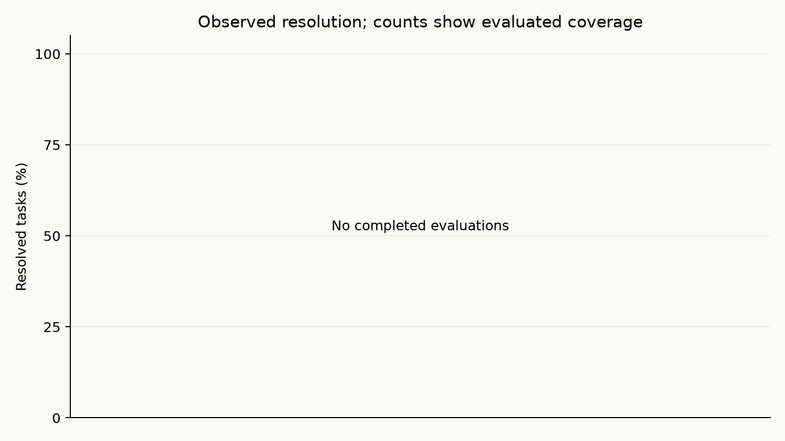
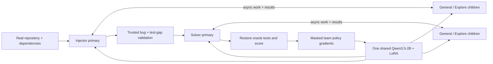

# Local multi-agent self-play RL

Train one local language model to introduce and repair bugs in real Python repositories. Both teams use the same Qwen3.5-2B weights and one shared LoRA adapter. Primary agents delegate work to subagents, keep working while they run, and receive results asynchronously. Executable tests provide rewards; every primary/child generation in a completed group enters its team's policy-gradient update once per optimization pass (zero-advantage groups make no update).

The project adapts [Self-play SWE-RL](https://arxiv.org/html/2512.18552v3), the [CWM training objective](https://arxiv.org/html/2510.02387v1#A3), and [OpenCode's subagent interface](https://github.com/anomalyco/opencode/blob/e761e265d2d5e6ff4a1c0756ab8d8eeee0db501e/packages/core/src/tool/plugin/subagent.ts) to one laptop GPU. It tests whether self-play gains transfer to independently held-out human bugs; [prior work](https://arxiv.org/html/2607.03523v1) shows that synthetic gains alone are insufficient evidence.

**Research status:** the harness, frozen cohorts and CPU validation are implemented. The initial GPU preflight was interrupted before any saved model generation or checkpoint. A [dated recovery amendment](reports/preregistration.md#recovery-amendment-2026-11-05) preserves that attempt and deducts its compute charge from the recovery allocation. No improvement or trained-model result is claimed. The first delivery executes one pilot, not the larger seed/control study.

<!-- SSR_RESULTS:START -->

Recorded run status: **pilot_interrupted**.

Recorded failure history (retained after later successful phases):

- 2026-11-05T21:30:15.600645+00:00, **preflight**: RuntimeError: Generation/scoring log probabilities disagree: 0.152308.
- 2026-11-05T21:58:00.073528+00:00, **preflight**: RuntimeError: Generation/scoring log probabilities disagree: 0.152151.

## Interrupted attempt and recovery amendment

Prior attempt runs/pilot has recorded status preflight_failed. Its original wall-clock deadline was 2026-10-30T15:31:24.450111+00:00; original deadline preserved: True. Recorded prior failure: preflight: BrokenPipeError: [Errno 32] Broken pipe. The prior attempt's recorded elapsed time was 479.063 seconds. The recovery amendment charges 600 seconds for that attempt and allocates 28200 seconds to this recovery, within 28800 seconds of total active allocation. The amendment excludes the offline interval; it does not erase the expired original attempt. Saved prior artifacts: model outputs 0, evaluations 0, checkpoints 0. Recorded reason: User requested recovery after OS restart. Original preflight failed with BrokenPipeError; original wall-clock deadline expired. Offline interval is excluded only by the dated preregistration amendment.

## Unscored protocol diagnostics

At 2026-11-05T22:49:05.240382+00:00, episode 97baaad7b45b4308bd6fed5b9fdcc085, task pytest-dev__pytest-5631, code e49e7442f0243efcbd00879327525c4f04639a0b: chat_eos_mismatch; status interrupted_unscored. Recorded model calls: 9; generated tokens: 2094; calls continuing after chat EOS: 9. Source-model EOS IDs: [248044]; tokenizer EOS ID: 248046. Stopped at 2026-11-05T22:47:26.520168+00:00. Recorded reason: Pinned model text config stops only on endoftext; tokenizer ends assistant turns with im_end. Model generated im_end then continued fabricating user/tool observations. No completed benchmark outcome or research update preceded correction. Incomplete streaming call, if any, remains in model.jsonl but lacks a completed action record.. Correction: Stop on the deduplicated union of model and tokenizer EOS IDs. Retain stop token and its behavior log probability. No post-hoc truncation of saved trajectories; retry same task from fresh base initialization. Both evaluation conditions and all training agents use the corrected stop contract..

These are unscored harness diagnostics, excluded from benchmark success and training. Their recorded calls and tokens remain visible as physical model usage; action-event counters retain the corresponding diagnostic events without adding these summaries again. Model-authored role or observation text is generated text; only recorded harness tool events establish actual tool execution.

| Bug source | Condition | Planned | Attempted | Resolved / scored | Rate | Unscored recorded | Unrecorded |
| --- | --- | ---: | ---: | ---: | ---: | ---: | ---: |
| human | base | 32 | 1 | Not evaluated | Not evaluated | 1 | 31 |
| human | trained | 32 | 0 | Not evaluated | Not evaluated | 0 | 32 |
| synthetic | base | 16 | 0 | Not evaluated | Not evaluated | 0 | 16 |
| synthetic | trained | 16 | 0 | Not evaluated | Not evaluated | 0 | 16 |

### Human bugs

Not evaluated: no tasks have completed outcomes for both conditions.

### Synthetic bugs

Not evaluated: no tasks have completed outcomes for both conditions.

| Deferred condition | Purpose | Result |
| --- | --- | --- |
| single-agent self-play | Separate delegation from self-play training | Not run |
| repair-only training | Control for updating the injector | Not run |
| procedural-mutation training | Control the training bug distribution | Not run |
| no-delegation evaluation | Measure inference-time delegation dependence | Not run |
| seed sensitivity | Measure training-seed variation | Not run |



[Experiment report](reports/generated/experiment.md) · [PDF paper](reports/generated/paper.pdf)

Regenerate all results with `uv run selfplay report --run <run-directory>`.

<!-- SSR_RESULTS:END -->



## Install and prepare

Run in WSL2 Ubuntu with Python 3.12, Docker Engine, an NVIDIA CUDA-capable GPU, and `uv`. The tested machine has an RTX 5070 Laptop GPU; memory feasibility is measured by preflight, not assumed from model size. Dependencies are locked in `uv.lock`; installing every package's independent latest version would violate Unsloth's compatibility requirements.

```bash
cp .env.example .env
uv sync --extra gpu --extra benchmark
uv run --no-sync selfplay doctor
uv run --no-sync selfplay prepare
```

Set `SSR_DATA_DIR`, `HF_HOME`, and `UV_CACHE_DIR` in `.env` to task-specific storage. The example uses `/mnt/d/AI/multi-agent-ssr`. Training is local; no remote model API or API key is required. Docker images and public models require network access during preparation, while agent execution has networking disabled. Never commit `.env`, private reference patches, raw credentials or model weights to Git.

Preparation pins model/source/dataset commits, builds dependency-only training images, freezes the human evaluation cohort, and prepares the independently validated diagnostic set. Humanize uses its upstream `uv build`/hatch-vcs hook to generate required version metadata. Source/data licenses and immutable revisions are retained in manifests.

## Run the research pipeline

Read [the preregistration](reports/preregistration.md) before running. Commit and push code, configuration and manifests first; the CLI enforces this ordering.

```bash
uv run --no-sync python -m pytest tests -q
uv run --no-sync selfplay preflight --run runs/pilot
uv run --no-sync selfplay pilot --run runs/pilot
uv run --no-sync selfplay report --run runs/pilot
```

Preflight verifies real generation, likelihood accounting, maximum-shape backward propagation, an adapter update and checkpoint reload. Its synthetic-check adapter is never the research initialization. The pilot evaluates the unchanged model, collects complete self-play groups, updates the shared adapter, checkpoints, and evaluates the last completed checkpoint. The persisted eight-hour deadline includes preflight and evaluations. Restarting cannot reset it.

The documented restart recovery uses `--config configs/pilot_recovery.toml --run runs/pilot-recovery` for both preflight and pilot, then `selfplay report --run runs/pilot-recovery`. Its separate, reduced deadline and original failure evidence are committed in the recovery manifest. For long runs, redirect the supervisor's stdout/stderr directly to a file and attach a terminal using `tail -f`; closing that display then leaves the worker's output destination intact. Keep the original run directory.

The report command regenerates Markdown, PDF, tables, plots and dashboard data from result files. Raw prompts, complete model outputs, tool events, exact sampled token IDs, behavior log probabilities, policy versions and session-parent identities are timestamped and preserved. Terminal logging is streamed. Observations may be bounded for the model's small context; the underlying log records are not truncated.

## Method and constraints

The injector changes source code and weakens existing tests. The harness verifies clean passing tests, induced failures, successful weakening, and the causal contribution of each modified source file. The solver receives a fresh buggy snapshot and reversed test patch, with no clean implementation, injection diff or original history. Scoring restores original tests/configuration in a separate sandbox.

Each team's root and children share a terminal reward. Independent child conversations are scored in their actual contexts, not flattened into the parent's transcript. Copied child outputs are observations and are not counted twice. Inference requests take turns on one GPU while tool execution and sessions overlap; updates wait until all workers finish. The implementation uses BF16 mixed-precision training of one language-only LoRA adapter following [Unsloth's Qwen3.5 guide](https://unsloth.ai/docs/models/qwen3.5/fine-tune.md), with frozen vision, embeddings, output head and base weights. Model-load records distinguish the actual parameter storage dtypes from the forward compute precision.

The primary evaluation is a preregistered subset of SWE-bench Verified using its official grader. Synthetic diagnostics are reported separately. Reported scores must include coverage and paired uncertainty. This small, single-seed pilot cannot establish robustness, full-benchmark performance, absence of pretraining contamination, or a causal benefit from multi-agent delegation alone.

## Project layout

- `src/multi_agent_ssr/`: phase wrapper, shared contracts, asynchronous agents, model backend, sandbox, validator, objective, evaluations and reporting.
- `configs/` and `manifests/`: preregistered settings and frozen identities.
- `tests/`: behavior, math, isolation and pipeline checks.
- `reports/` and `docs/`: preregistration, generated experiments, methodology and sources.
- `site/`: static interactive results explorer deployed through GitHub Pages.
- `runs/` (ignored): exact private traces, temporary workspaces, checkpoints and raw outcomes.

See [optional controls and sensitivity runs](docs/controls.md), [sources and licensing](docs/sources.md), and [research instructions](AGENTS.md). Source code is MIT licensed; dependencies, pretrained weights and upstream repositories retain their own licenses.
