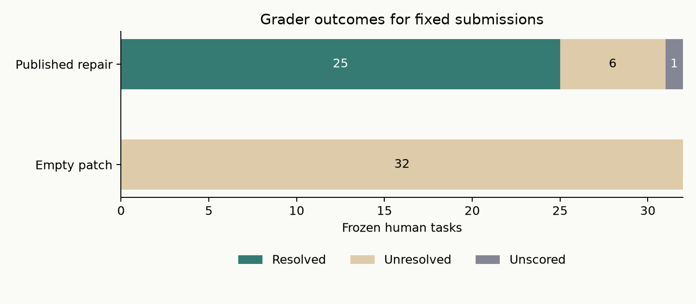

# Local multi-agent self-play RL for software engineering

Libor "Burny" Burian

Report generated: 2026-11-26. Original run dates are retained below.

## Abstract

The primary learning hypothesis was not tested. The research run recorded zero optimizer steps and selected an adapter identical to initialization. We implement a local shared-policy extension of Self-play SWE-RL in which bug-injection and repair teams can delegate to asynchronous subagents. All roles use one Qwen3.5-2B policy with a shared trainable LoRA adapter. Across 21 paired tasks, the final-minus-base resolution difference was +0.0 percentage points (95% paired bootstrap interval [+0.0, +0.0]). Improved: 0; regressed: 0; unchanged: 21. The bootstrap interval is degenerate; it does not establish equivalence or rule out a population effect. Fresh CPU grader controls distinguished the published repair from an empty patch on 25 of 32 frozen human tasks [16–19].

## Context and motivation

The experiment asks whether reinforcement learning from executable repository feedback improves held-out human-bug repair. Prior SSR work motivates repository-grounded bug injection and repair [1]. Anchored Self-Play reports distribution drift in function-level BugSourceBench repair [7]. That motivates separate evaluation here but does not validate this repository-level adaptation.

## Method

The injector edits source and weakens existing tests. A trusted Python runner validates the artifact, including restoration checks and inverse mutations. The repair team sees the weakened buggy state and the inverse weakening patch, but not clean reference code or the injection patch. Original oracle tests are restored for scoring. This Python test interface is a deliberate adaptation of SSR's more general artifact-discovery procedure [1].

## Task construction and trusted validation

The clean selected test suite must contain at least five passing tests. The source mutation must induce a failure and preserve a pass. The weakening patch must hide at least one induced failure. The local validator accepts a strict reduction in failing test IDs, including removal of an exposing test. SSR describes an exposed failure that passes after weakening [1]. Inverse mutation checks revert each changed source file independently and require that reversal to repair at least one induced failure. At repair scoring, missing expected tests, collection failures, and parser errors cannot produce success. Artifacts retain the SSR five-file interface: source mutation, test weakening, selected test files, runner, and parser; the last two are constructed by this harness rather than delegated to a model [1]. One failed repair per original bug can become an independently revalidated second-order task. Its repair attempts contribute solver gradients; the original injector return uses first-order attempts only.

## Agents and optimization

Primary agents delegate through a tool patterned after OpenCode [3]. Child sessions have independent contexts and can work while the primary agent continues. GPU generation requests are serialized through the shared policy. One team execution includes all descendant actions. Each actual generated token belongs to one action record; nonzero-advantage actions contribute once per optimization pass. A child's text repeated in its parent's context is an observation. The update extends CWM's length-weighted centered returns, clipped token likelihood ratios, and action masks [2]. The precise run configuration is included in the appendix.

## Exact objective and team credit

For a group G of episodes with the same task and team role, let L_e be the number of unique generated action tokens and R_e the episode return. The length-weighted baseline and advantage are mu_G = sum_e(L_e R_e) / sum_e(L_e), and A_e = R_e - mu_G. Injector and solver groups remain separate. Every primary/child action in episode e receives A_e; prompt tokens, tool output, and copied child output receive no action loss [2].

For an action token t, r_et = exp(log pi_theta(a_et | original_context_et) - old_logprob_et). The minimized objective is L(theta) = -(1/C) sum_G sum_e sum_t min(r_et A_e, clip(r_et, 0.8, 1.25) A_e). C is the maximum planned collection token capacity, not the observed trajectory length. In primary self-play, C = injector_samples * (1 + repair_samples * max_bug_order) * team_generated_token_budget. There is no reward-standard-deviation normalization or KL term. Each eligible nonzero-advantage generated call contributes once per optimization pass. The original behavior log probabilities remain fixed across passes. Clipping and normalization follow CWM Section 5.2 [13]; team-level grouping and capacity are local adaptations [14].

Injector returns follow SSR: -1 for an invalid artifact; -0.8 for a valid bug with empirical repair success rate s equal to zero or one; otherwise 1 - 1.8s. A repair receives +1 only when the restored oracle passes completely, and -1 otherwise [1]. Zero-advantage groups are recorded without an update. Incomplete or infrastructure-corrupted groups never enter optimization.

## Model, sampling, and optimization settings

The recorded model is Qwen/Qwen3.5-2B at revision 15852e8c16360a2fea060d615a32b45270f8a8fc. LoRA rank is 16, alpha 16, and learning rate 5e-06; recorded training seed is 0. The implementation uses BF16 mixed-precision LoRA training with dropout zero, a frozen base, frozen vision tower, embeddings and output head, and language-model attention/MLP adapters only [4, 5].

Recorded parameter storage counts (scalar elements, separate from compute dtype): frozen:torch.bfloat16 = 2213035584, frozen:torch.float32 = 206080, trainable:torch.float32 = 16819200.

A call has at most 2048 input-plus-action tokens and 256 generated tokens. Each team shares a generated-token cap of 4096, a tool-call cap of 32, and 2 child sessions at depth 1. Sampling temperature is one; thinking is disabled. Root and child threads progress concurrently, but calls acquire one shared GPU policy lock. All workers finish before an update.

The configuration requests 2 injector episodes per clean starting state and 4 repairs per valid bug, with 2 optimization passes for nonzero-advantage groups. These are design settings, not counts of executed repairs or updates. AdamW uses betas (0.9, 0.99), weight decay zero, gradient clipping at norm 1.0, gradient checkpointing, and one call per microbatch. Likelihood computation retains only action-position logits and accumulates gradients sequentially.

## Evaluation and analysis

Frozen and final policies are compared on matched tasks and inference budgets. Task-level paired percentile bootstrap intervals use the resampling scheme in [8]. Only completed boolean outcomes are scored. Infrastructure failures and unfinished evaluations are reported as missing coverage, not failed repairs. Conflicting duplicate completed outcomes are rejected. The final checkpoint is selected by completion order rather than held-out score.

## Evaluation sampling and stopping

Planned human and synthetic task counts in the run manifest are 32 and 16. Human tasks are fixed before training by sorting SHA-256 instance-ID hashes within the eligible requests, Flask, pylint, and pytest repositories. Synthetic humanize mutations are selected by deterministic syntax and executable validity, with at most one accepted mutation per function. Neither cohort is selected using model performance. Gold human fixes and evaluator test patches are withheld from agents [6].

Each source is analyzed separately with 10000 task resamples, bootstrap seed 0, and percentile endpoints at 2.5% and 97.5%. The paired difference is mean(trained_success - base_success) over completed pairs. A positive lower bound returns the preregistered support decision; an upper bound at or below zero returns its contradiction decision; otherwise the rule is inconclusive. These are mechanical decisions and require an actual learning intervention to test the learning hypothesis. Degenerate intervals are explicitly qualified [8, 9].

This run's recorded single-GPU wall-clock cap is 28200 seconds. It includes model loading, compilation, preflight, baseline, training, and final evaluation, using a persisted deadline that restarts cannot reset. Baseline allocation is capped at (remaining - 1800) / 2.25 seconds. Training reserves the greater of the configured minimum final-evaluation reserve and 1.25 times measured baseline runtime. A new collection starts only when the remaining allocation exceeds an estimate based on previous group durations, with a margin; this does not guarantee timely completion. If an optimizer pass crosses the reserve boundary, restore the last complete checkpoint. Nonfinite gradients, memory failure, likelihood incompatibility, or corrupt state stop training without a silent model/precision substitution. Preregistration and any amendments remain authoritative [9].

## Differences from prior SSR

This is a Python-only, local, single-GPU adaptation, not a numerical reproduction of SSR [1]. It uses Qwen3.5-2B, one tied LoRA adapter for both teams and all descendants, asynchronous prompted delegation, trusted pytest execution/JUnit parsing, bounded contexts, and a small fixed evaluation cohort. It does not reproduce SSR's original model scale, context length, distributed asynchronous learner, git-history-aware bug-injection prompts, or full evaluation suite. The CWM objective is extended from trajectories to complete action trees using the exact original contexts [2].

## Interrupted attempt and recovery amendment

Prior attempt runs/pilot has recorded status preflight_failed. Its original wall-clock deadline was 2026-10-30T15:31:24.450111+00:00; original deadline preserved: True. Recorded prior failure: preflight: BrokenPipeError: [Errno 32] Broken pipe. The prior attempt's recorded elapsed time was 479.063 seconds. The recovery amendment charges 600 seconds for that attempt and allocates 28200 seconds to this recovery, within 28800 seconds of total active allocation. The amendment excludes the offline interval; it does not erase the expired original attempt. Saved prior artifacts: model outputs 0, evaluations 0, checkpoints 0. Recorded reason: User requested recovery after OS restart. Original preflight failed with BrokenPipeError; original wall-clock deadline expired. Offline interval is excluded only by the dated preregistration amendment.

## Unscored protocol diagnostics

At 2026-11-05T22:49:05.240382+00:00, episode 97baaad7b45b4308bd6fed5b9fdcc085, task pytest-dev__pytest-5631, code e49e7442f0243efcbd00879327525c4f04639a0b: chat_eos_mismatch; status interrupted_unscored. Recorded model calls: 9; generated tokens: 2094; calls continuing after chat EOS: 9. Source-model EOS IDs: [248044]; tokenizer EOS ID: 248046. Stopped at 2026-11-05T22:47:26.520168+00:00. Recorded reason: Pinned model text config stops only on endoftext; tokenizer ends assistant turns with im_end. Model generated im_end then continued fabricating user/tool observations. No completed benchmark outcome or research update preceded correction. Incomplete streaming call, if any, remains in model.jsonl but lacks a completed action record.. Correction: Stop on the deduplicated union of model and tokenizer EOS IDs. Retain stop token and its behavior log probability. No post-hoc truncation of saved trajectories; retry same task from fresh base initialization. Both evaluation conditions and all training agents use the corrected stop contract..

These are unscored harness diagnostics, excluded from benchmark success and training. Their recorded calls and tokens remain visible as physical model usage; action-event counters retain the corresponding diagnostic events without adding these summaries again. Model-authored role or observation text is generated text; only recorded harness tool events establish actual tool execution.

## Results

Recorded run status: pilot_failed. Recorded failure at 2026-11-05T21:30:15.600645+00:00 in preflight: RuntimeError: Generation/scoring log probabilities disagree: 0.152308. Recorded failure at 2026-11-05T21:58:00.073528+00:00 in preflight: RuntimeError: Generation/scoring log probabilities disagree: 0.152151. Recorded failure at 2026-11-06T04:49:29.416350+00:00 in pilot: Worker and supervisor remained alive 45.619 seconds past the persisted wall-clock deadline; the worker process group was externally terminated. The interrupted task has no admitted score. The overrun's cause is not established.. No completed policy optimizer steps are recorded; this record does not establish a learned checkpoint.

Recorded research optimizer steps: 0. The initial and selected adapter weights and configurations have identical SHA256 digests and the same pinned base identity. This is two evaluations of unchanged weights, not an estimated self-play training effect. The planned learning hypothesis was not tested by this unchanged-policy comparison. The raw trained label and mechanical preregistered interval decision are preserved for provenance. Across 21 paired tasks, the final-minus-base resolution difference was +0.0 percentage points (95% paired bootstrap interval [+0.0, +0.0]). Improved: 0; regressed: 0; unchanged: 21. The bootstrap interval is degenerate; it does not establish equivalence or rule out a population effect.

Synthetic diagnostic set: Not evaluated: no tasks have completed outcomes for both conditions.

| Bug source | Condition | Planned | Attempted | Resolved / scored | Rate | Unscored recorded | Unrecorded |
| --- | --- | ---: | ---: | ---: | ---: | ---: | ---: |
| human | base | 32 | 22 | 0 / 21 | 0.0% | 11 | 0 |
| human | final condition | 32 | 30 | 0 / 29 | 0.0% | 3 | 0 |
| synthetic | base | 16 | 0 | Not evaluated | Not evaluated | 16 | 0 |
| synthetic | final condition | 16 | 0 | Not evaluated | Not evaluated | 16 | 0 |

| Deferred condition | Purpose | Result |
| --- | --- | --- |
| single-agent self-play | Separate delegation from self-play training | Not run |
| repair-only training | Control for updating the injector | Not run |
| procedural-mutation training | Control the training bug distribution | Not run |
| no-delegation evaluation | Measure inference-time delegation dependence | Not run |
| seed sensitivity | Measure training-seed variation | Not run |

## Collection and training exposure

The 2 completed groups contained 4 injector episodes. 4 reached the tool budget with no declared test targets. 4 episodes had zero length-centered advantage. The original action stream matched 138 saved collection actions. The effective messages for 128 distinct training prompt token sequences contained 0 verbatim complete held-out reference or test patches. Partial overlap, memorization and pretraining exposure remain unknown. [2, 14, 19]

## Human cohort and missing outcomes

The frozen selection took 32 tasks from 38 eligible rows of the 500-row pinned dataset. Both conditions were scored on 21 tasks, base only on 0, final only on 8, and neither on 3. Assigning every missing binary outcome its extremes gives a possible net change of -11 to +3 resolutions out of 32 (-34.38 to +9.38 percentage points). These endpoints describe possible completions of this finite cohort. The paired bootstrap describes only the observed pairs. [8, 17, 19]

## Replay of historical scoring

The locked scorer reproduced all 50 archived human grades from stdout. 50 of the submitted patches were empty. 14 scored submissions recorded zero generated tokens and 15 recorded an agent context-limit error. A recorded failure can therefore include a task for which the agent could not generate a repair. The PASS_TO_PASS failure category contained 208 entries across 9 submissions on 5 tasks. Parsed states among those entries were {"FAILED": 208}. The FAIL_TO_PASS failure category contained 122 entries, with parsed states {"FAILED": 100, "MISSING": 22}. Expected IDs included a literal pytest progress marker on 2 tasks. 4 of the 4 affected submissions also had a separate repair-required failure. Test-level classifications and alias matches are retained in the per-test archive. [16, 19]

## Fixed-patch grader calibration

The grader resolved the published repair and rejected the empty patch on 25/32 tasks. The remaining classifications were 6 failed and 1 indeterminate. Gold repairs resolved on 25/32 planned tasks. Empty submissions resolved on 0/32. These CPU measurements characterize the pinned grading environment. A passing pair validates only these two inputs. [16–19]



## Sensitivity to grader discrimination

Of 25 tasks passing calibration, 16 had both historical policy scores and 9 lacked at least one. The final-minus-base difference is +0.0 percentage points (paired percentile interval [+0.0, +0.0]). The restriction was specified before control execution and after the pilot outcomes were known. The full original analysis retains every admitted score. [8, 18, 19]

## Synthetic diagnostic cohort

The private records and public manifest agree on 16 mutations across 16 distinct functions. The saved clean suite sizes were 723. The policy evaluation stream contains 0 scored synthetic outcomes. [9, 19]

## Where reference repairs failed

Among the completed gold controls, the grader rejected 6 in psf/requests. On 2 of these tasks all repair-required tests were accepted, but expected-pass failures still blocked resolution. Original stdout contained a DNS or network-unreachable message on 6/6 unresolved gold controls. This retrospective text check identifies a concrete environmental limitation. The data do not isolate the cause of every failed test. [16, 18, 19]

## Protocol changes and stopping

The interrupted original pilot records match the recovery amendment. The final observed worker overrun was 45.619 seconds. The stopping diagnostic identified 9 calls continuing past chat EOS in the unscored held-out episode. That exposure preceded the stopping correction. The likelihood gate was also amended after inspection of the same preflight sample. [9, 19]

## Recorded training outcome

Completed collection groups: 2 (with saved training_group outcomes); valid bugs / injector episodes: 0 / 4; recorded repair attempts: 0; zero-advantage episodes: 4; optimizer steps: 0. Collection groups with sampled actions but only zero advantages: 2. Subtracting the length-weighted group mean turns equal returns into zero advantages. These groups had no nonzero-advantage action tokens and recorded no learning update. Saved invalidity reason counts across all logged artifact checks, including incomplete collections: {"At least one test target is required": 4}.

## Preflight likelihood diagnostics

Check at 2026-11-05T21:58:00.067+00:00: 101 sampled action tokens; maximum cached-replay log-probability difference 0; maximum trainer-versus-sampling log-probability difference 0.152151. Pre-update scoring/behavior ratio range [0.858858, 1.10626]; 0/101 tokens outside [0.8, 1.25]. Recorded trainer guard: absolute log-probability difference limit 0.05; cached-replay difference limit 0.05. Check at 2026-11-05T22:16:41.480+00:00: 101 sampled action tokens; maximum cached-replay log-probability difference 0; maximum trainer-versus-sampling log-probability difference 0.151829. Pre-update scoring/behavior ratio range [0.859135, 1.06795]; 0/101 tokens outside [0.8, 1.25]. Recorded trainer guard: preupdate_ratios_inside_clip_interval with interval [0.8, 1.25]; cached-replay difference limit 0.05. CWM retains sampled behavior probabilities in the denominator [2]. Upstream Qwen analysis attributes some BF16 cached/full-forward differences to rounding [10]. Each check is a single-prompt software diagnostic; it does not bound drift in training contexts or establish training quality.

## Observed execution diagnostics

The following diagnostics are derived from saved event, evaluation, and optimizer streams, including incomplete collections and unscored protocol diagnostics. Counts describe recorded activity, not generalization. Preflight memory belongs to a software check, not a trained-model evaluation. Recorded action tokens from research agents (excluding preflight): 64920; actual subagent tool calls: 8; child sessions: 7; optimizer steps: 0. Full invalidity reasons, exclusions, failure metadata, and per-task outcomes accompany the generated report.

| Recorded diagnostic | Value |
| --- | ---: |
| episodes | 57 |
| child sessions | 7 |
| episodes with children | 7 |
| delegation rate | 0.122807 |
| delegation calls | 8 |
| generated tokens from research agents (excludes preflight) | 64920 |
| generation calls by research agents (excludes preflight) | 1322 |
| artifact validation checks (accepted and rejected) | 4 |
| accepted valid artifacts | 0 |
| invalid artifacts | 4 |
| invalid artifact rate | 1 |
| optimizer steps | 0 |
| recorded training groups | 2 |
| peak allocated bytes | 5136889856 |
| evaluation seconds | 18533.5 |
| training group seconds | 995.584 |
| PASS_TO_PASS failure entries (causal attribution unverified) | 208 |
| scored rows with PASS_TO_PASS reports | 50 |

## Runtime interface and context diagnostics

This post-hoc descriptive analysis counts 1242 actual tool_finished events across recorded phases, excluding protocol-diagnostic episodes. Of these, 426 have result.error values, including 316 ValueError unsafe-path rejections. Generated text and nonzero command/test exit codes alone are not counted as tool errors. Evaluation agent_error counts are separated by source/condition after the report's task deduplication, excluding protocol diagnostics: human/base: 6 ContextLimitError records among 32 retained rows (6 with completed scoring); human/trained: 10 ContextLimitError records among 32 retained rows (9 with completed scoring); synthetic/base: 0 ContextLimitError records among 16 retained rows (0 with completed scoring); synthetic/trained: 0 ContextLimitError records among 16 retained rows (0 with completed scoring). Completed scoring can still be recorded after an agent context error.

Native read/edit path arguments require repository-relative paths [11]. The frozen prompt says Work in /repo without explicitly stating that read/edit path arguments must be relative [12]. This interface limitation and the fixed context capacity are potential confounders when interpreting repair outcomes. These counts do not establish a causal explanation for every unresolved result. Prompts, API semantics, and budgets remain fixed after held-out scoring; this analysis does not adapt them to observed benchmark outcomes.

## Official test failures and empty patches

The saved official reports contain 208 PASS_TO_PASS failure entries across 9 scored rows. Of those rows, 9 submitted an empty patch. Across all 50 scored human rows, 50 saved patches are empty. These are failures of tests designated as passing in benchmark metadata, not established regressions caused by agent edits. The grader's failure category can also include tests missing from parsed output. The archived score alone cannot identify the cause of an expected-pass failure. The official scores remain unchanged, with this limitation on their interpretation. This is a post-hoc descriptive check of saved reports and submitted patches. Grading semantics: [6].

## Claims and implications

These measurements are a comparison of the recorded policies under this harness. They do not isolate the causal contribution of delegation, self-play, or parameter sharing. Those claims require the planned controlled comparisons. A functioning update or improved training reward alone does not establish better software engineering.

## Related work

SSR supplies the bug/repair self-play task [1], CWM supplies the optimization foundation [2], and OpenCode supplies a reference for tool-mediated child sessions [3]. The model and local LoRA configuration follow Qwen and Unsloth documentation [4, 5]. Human-bug scoring uses the SWE-bench harness [6]. This implementation does not claim the first bug/repair self-play method.

## Limitations and discussion

The pilot uses one training seed, a small task sample, a short context window, and limited compute. Task bootstrap intervals condition on this checkpoint and cannot quantify training-seed variation. Small samples can yield degenerate intervals. Public repositories may have appeared in model pretraining; contamination is unknown. Trusted tests reduce particular scoring failures but cannot guarantee realism or prevent every form of reward gaming. Unrun controls are not evidence. All incomplete coverage is retained in the tables.

## Conclusion

The primary learning hypothesis was not tested. The research run recorded zero optimizer steps and selected an adapter identical to initialization. Across 21 paired tasks, the final-minus-base resolution difference was +0.0 percentage points (95% paired bootstrap interval [+0.0, +0.0]). Improved: 0; regressed: 0; unchanged: 21. The bootstrap interval is degenerate; it does not establish equivalence or rule out a population effect. Fresh CPU grader controls distinguished the published repair from an empty patch on 25 of 32 frozen human tasks [16–19].

## Appendix: configuration

```json
{
  "created_at": "2026-11-05T20:58:47.386714+00:00",
  "code_commit": "57f5624bd567110799ee098a7c0ea27d5abef608",
  "config": {
    "model": {
      "model_id": "Qwen/Qwen3.5-2B",
      "revision": "",
      "context_tokens": 2048,
      "action_tokens": 256,
      "lora_rank": 16,
      "lora_alpha": 16,
      "learning_rate": 5e-06,
      "seed": 0
    },
    "limits": {
      "generated_tokens": 4096,
      "tool_calls": 32,
      "child_sessions": 2,
      "child_depth": 1,
      "command_seconds": 90,
      "episode_seconds": 900
    },
    "experiment": {
      "budget_seconds": 28200,
      "injector_samples": 2,
      "repair_samples": 4,
      "optimization_passes": 2,
      "max_bug_order": 2,
      "human_tasks": 32,
      "synthetic_tasks": 16,
      "minimum_final_reserve_seconds": 7200,
      "delegation": true,
      "condition": "selfplay",
      "bootstrap_samples": 10000,
      "recovery_evidence": "manifests/recovery.json"
    }
  },
  "recovery": {
    "prior_run": "runs/pilot",
    "prior_status": "preflight_failed",
    "prior_budget": {
      "started_epoch": 1793345484.450111,
      "budget_seconds": 28800,
      "deadline_epoch": 1793374284.450111,
      "started_at": "2026-10-30T07:31:24.450125+00:00"
    },
    "prior_events": [
      {
        "timestamp": "2026-10-30T07:31:26.384084+00:00",
        "event": "phase_started",
        "phase": "preflight",
        "code_commit": "a49d13369ec17c005c844af17b88aa6dff66d86a",
        "remaining_seconds": 28798.066036701202
      },
      {
        "timestamp": "2026-10-30T07:39:23.513025+00:00",
        "event": "phase_failed",
        "phase": "preflight",
        "error": "BrokenPipeError: [Errno 32] Broken pipe"
      }
    ],
    "prior_attempt_elapsed_seconds": 479.0629141330719,
    "charged_prior_seconds": 600,
    "recovery_budget_seconds": 28200,
    "total_active_allocation_seconds": 28800,
    "original_deadline_preserved": true,
    "saved_model_generations": 0,
    "saved_checkpoints": 0,
    "saved_evaluations": 0,
    "original_record_sha256": {
      "budget.json": "c2efc46ea1aa4ee59e82a08855ddfb74b3bb4811a45b39b625b55d1bed5202e4",
      "events.jsonl": "0387ecd61f92982dc0ccdd31746f45b8f276885d72b20318c66c45bac00ecc27",
      "manifest.json": "15d1cfe5cd7cd423c536b23b5e0b60644258ed9e72b99d2c0c1a447d429a0160",
      "terminal.log": "b529901c78267e59030d5ee1fdd0687a60970ab8b3867a0f40a3cb63200af8fd"
    },
    "reason": "User requested recovery after OS restart. Original preflight failed with BrokenPipeError; original wall-clock deadline expired. Offline interval is excluded only by the dated preregistration amendment."
  },
  "model": {
    "model_id": "Qwen/Qwen3.5-2B",
    "revision": "15852e8c16360a2fea060d615a32b45270f8a8fc",
    "context_tokens": 2048,
    "action_tokens": 256,
    "lora_rank": 16,
    "lora_alpha": 16,
    "learning_rate": 5e-06,
    "seed": 0
  },
  "hardware": "name, memory.total [MiB], compute_cap\nNVIDIA GeForce RTX 5070 Laptop GPU, 8151 MiB, 12.0\n",
  "expected_human_tasks": 32,
  "expected_synthetic_tasks": 16,
  "hypothesis": "Trained team improves held-out human bug resolution over frozen initialization",
  "phase_code_commits": {
    "preflight": "05d7f357458d9eee1ec64637ff0277464839be06",
    "pilot": "109dfa67740ff9f0260d22be9407d047d90565f7"
  }
}
```

## References

1. [Self-play SWE-RL: task construction and rewards](https://arxiv.org/html/2512.18552v3)
2. [CWM: clipped token objective and trajectory masks](https://arxiv.org/html/2510.02387v1#A3)
3. [OpenCode: asynchronous child sessions](https://github.com/anomalyco/opencode/blob/e761e265d2d5e6ff4a1c0756ab8d8eeee0db501e/packages/core/src/tool/plugin/subagent.ts)
4. [Qwen3.5-2B pinned model card](https://huggingface.co/Qwen/Qwen3.5-2B/blob/15852e8c16360a2fea060d615a32b45270f8a8fc/README.md)
5. [Unsloth Qwen3.5 fine-tuning](https://unsloth.ai/docs/models/qwen3.5/fine-tune.md)
6. [SWE-bench evaluation harness](https://www.swebench.com/SWE-bench/guides/evaluation/)
7. [Anchored Self-Play: synthetic-to-human bug distribution shift](https://arxiv.org/html/2607.03523v1)
8. [Paired percentile bootstrap procedure](https://docs.scipy.org/doc/scipy/reference/generated/scipy.stats.bootstrap.html)
9. [Committed preregistration and analysis plan](https://github.com/BurnyCoder/multi-agent-llm-self-play-reinforcement-learning-for-software-engineering/blob/main/reports/preregistration.md)
10. [Qwen3.5 cached/full-forward BF16 numerical analysis](https://github.com/huggingface/transformers/issues/46190)
11. [Frozen repository-relative path guard](https://github.com/BurnyCoder/multi-agent-llm-self-play-reinforcement-learning-for-software-engineering/blob/109dfa67740ff9f0260d22be9407d047d90565f7/src/multi_agent_ssr/sandbox.py#L29)
12. [Frozen agent prompt and native tool descriptions](https://github.com/BurnyCoder/multi-agent-llm-self-play-reinforcement-learning-for-software-engineering/blob/109dfa67740ff9f0260d22be9407d047d90565f7/src/multi_agent_ssr/agents.py#L146)
13. [CWM clipping thresholds and normalization choices](https://arxiv.org/html/2510.02387v1#S5.SS2)
14. [Frozen local reward and optimizer implementation](https://github.com/BurnyCoder/multi-agent-llm-self-play-reinforcement-learning-for-software-engineering/blob/109dfa67740ff9f0260d22be9407d047d90565f7/src/multi_agent_ssr/learning.py)
15. [Archived review of 2026-11-12](https://github.com/BurnyCoder/multi-agent-llm-self-play-reinforcement-learning-for-software-engineering/blob/main/reports/independent-audit-2026-11-12.md)
16. [Locked SWE-bench test matching and resolution](https://github.com/SWE-bench/SWE-bench/blob/490635b2e9e775dca1e1d6b40ce9dbcff91e780f/swebench/harness/grading.py)
17. [Frozen SWE-bench Verified dataset](https://huggingface.co/datasets/SWE-bench/SWE-bench_Verified/tree/78f471bf655a3137b2e8a75af1501690ec009ec3)
18. [Prospective fixed-patch control protocol](https://github.com/BurnyCoder/multi-agent-llm-self-play-reinforcement-learning-for-software-engineering/blob/d9bbab3/reports/reviews/grader-calibration-protocol-2026-11-26.md)
19. [Independent reconstruction, controls and per-test evidence](https://github.com/BurnyCoder/multi-agent-llm-self-play-reinforcement-learning-for-software-engineering/tree/main/results/scientific-audit-2026-11-26)

## AI statement

Codex wrote this codebase and paper from a specification provided by the human author. Human cleanup and rewriting are in progress.
